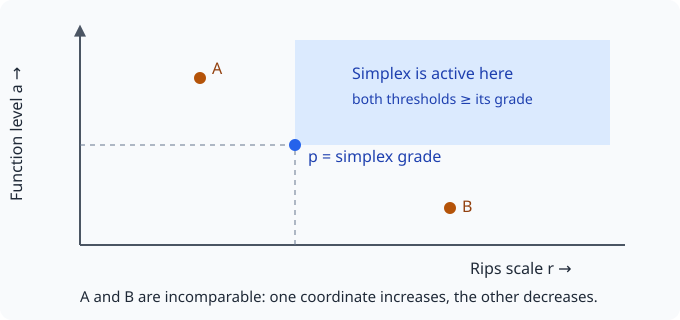

# MultiparameterPersistence.jl

```@meta
CurrentModule = MultiparameterPersistence
```

A single Rips scale asks whether nearby points form connected pieces or holes.
But scale alone cannot express “connect nearby points **while also excluding
points with a high outlier score**.” A function-Rips bifiltration keeps both
choices: a distance scale `r` and a vertex-function threshold `a`.

A simplex enters at the grade
``(\max_{i,j\in\sigma}\|x_i-x_j\|,\ \max_{i\in\sigma}f(x_i))``. It is active
at `(r,a)` when both coordinates of its grade are at most those thresholds.
Raising either parameter adds simplices; two grades can be incomparable when
one has a smaller scale and a larger level. That partial order is why the
one-dimensional barcode picture is not a complete description here.



This package computes exact F₂ homology and inclusion maps on small finite
two-parameter complexes. Its dense algorithms make intermediate mathematical
objects understandable and small examples reproducible. It does not compute
a complete classification of arbitrary multiparameter modules.

| Task | API | Result |
| --- | --- | --- |
| Build function-Rips from coordinates and values | [`bifiltration`](@ref) | [`Bifiltration`](@ref) |
| Supply your own simplices and valid grades | [`Bifiltration`](@ref) | Downward-closed graded complex |
| Count homology classes at each grade | [`hilbert_function`](@ref) | [`GridInvariant`](@ref) |
| Count simplices with alternating signs | [`euler_surface`](@ref) | Euler `GridInvariant` |
| Count generators, relations, and their dependencies | [`bigraded_betti`](@ref) | `beta0`, `beta1`, `beta2` grids |
| Encode a grid or exact Euler data by atoms | [`signed_measure`](@ref) | [`SignedMeasure`](@ref) |
| Evaluate shared Gaussian test functions | [`MeasureVectorizer`](@ref) | Fixed-length feature vector |
| Fit shared centers through an optional MLJ adapter | [`measure_vectorizer_model`](@ref) | Unsupervised transformer |

## Install and choose a small example

Use Julia ≥1.10. From the workspace containing a `JuliaTDA.jl` checkout:

```julia
using Pkg
Pkg.activate("multiparameter-example")
Pkg.develop(path="JuliaTDA.jl/lib/MultiparameterPersistence")
```

For a remote installation, use the repository subdirectory, as supported by
[Julia's Pkg API](https://pkgdocs.julialang.org/v1/api/):

```julia
Pkg.add(url="https://github.com/JuliaTDA/JuliaTDA.jl",
        subdir="lib/MultiparameterPersistence")
```

You can load `MultiparameterPersistence` on its own, without the umbrella package
or the PH forks. It uses `Tables` and `LinearAlgebra`. Load `MLJModelInterface`
only if you want the optional transformer; the docs environment includes it.

```@example first_square
using MultiparameterPersistence
points = [[0.,0.], [1.,0.], [1.,1.], [0.,1.]]
F = bifiltration(points, zeros(4); dim_max=1)
H = hilbert_function(F; scales=[0.,1.,sqrt(2)], levels=[0.], dim=1)
@assert H.values[:,1] == [0,1,0]
H.values
```

At scale 1 the square's four sides form a loop. At √2, diagonals and triangles
fill it. The [tutorial](tutorial.md) adds a point excluded by the second
parameter. Then [Understanding the invariants](invariants.md) separates homology
counts from algebraic generators and relations. Finish with [Signed measures
and MLJ](measures.md) and [Limits and reproducibility](practical.md) before
using the results as machine-learning features.
