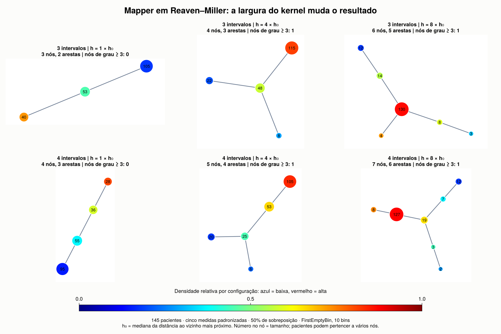
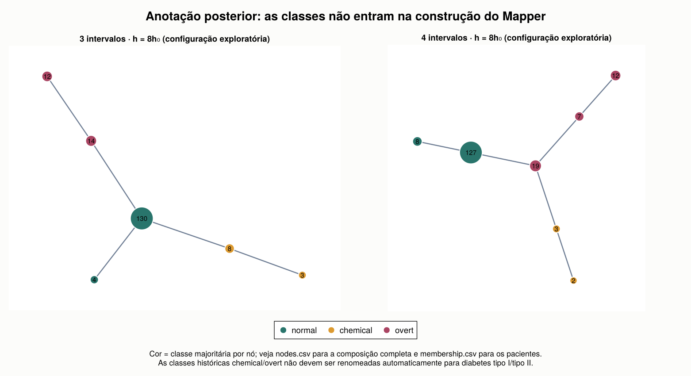
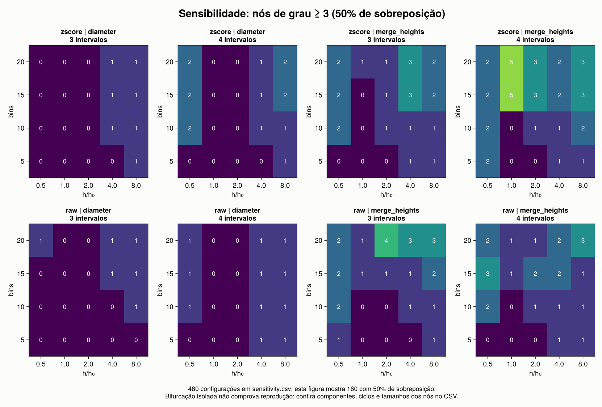

# Mapper 2007: Reaven–Miller

**Resultado: reprodução qualitativa parcial.** A pipeline JuliaTDA recuperou
uma região de maior densidade conectada a duas extremidades de menor densidade,
mas o resultado depende da largura do kernel e da regra de clustering. Os grafos
são mais grosseiros que a Figura 5; não obtivemos equivalência entre os nós
publicados e os nossos.



## Referência e limites do protocolo

Alvo: Figura 5 de [Singh, Mémoli e Carlsson (2007)](https://graphics.stanford.edu/courses/cs233-25-spring/ReferencedPapers/mapperPBG.pdf).
O experimento usa densidade Gaussiana, single linkage e 3/4 intervalos com 50%
de sobreposição. O texto menciona seis medidas, incluindo idade. A distribuição
pública encontrada contém cinco. O paper não especifica a largura do kernel,
o número de bins nem o pré-processamento desse experimento. Não inferimos
essas escolhas a partir da aparência da figura como se fossem informações
publicadas.

| Item | Execução atual |
|---|---|
| Dados | Os mesmos 145 sujeitos na distribuição Reaven–Miller; cinco medidas disponíveis |
| Idade | Ausente nas duas fontes consultadas; sem imputação |
| Escala | z-score por medida na ilustração; medidas brutas na sensibilidade |
| Densidade | `kde`, kernel `exp(-d²/(2h²))`, incluindo a contribuição do próprio ponto |
| Largura | `h = fator × h₀`; `h₀` é a mediana da distância ao vizinho mais próximo |
| Cobertura | Intervalos de largura igual, alinhados ao mínimo/máximo; interseção/largura = 0,5 |
| Clustering principal | `FirstEmptyBin(num_bins=10)`, com single linkage |
| Variante | Mesmo procedimento, mas histograma limitado ao máximo das alturas de fusão |
| Grafo | `SimpleNerve`: aresta se os dois nós compartilham ao menos um paciente |

O fator multiplicativo positivo que normalizaria a densidade não altera o
pullback de uma cobertura construída sobre o próprio intervalo de valores.
A parametrização Gaussiana equivale à fórmula do paper com `ε = 2h²`.
A convenção exata do histograma MATLAB original permanece desconhecida.

## Dados verificados

Baixamos o RData do pacote `rrcov` e uma segunda cópia do pacote `loon.data`,
em revisões fixas. A [documentação do mantenedor de rrcov](https://raw.githubusercontent.com/cran/rrcov/master/man/diabetes.Rd)
identifica as medidas `rw`, `fpg`, `glucose`, `insulin`, `sspg` e a referência
Reaven–Miller/Andrews–Herzberg.

As **725 medidas numéricas e as 145 classes coincidem na mesma ordem** entre
as duas distribuições. Há 76 sujeitos `normal`, 36 `chemical` e 33 `overt`.
`patient_id` identifica a posição original da linha, não uma identidade pessoal.
As classes são usadas somente para anotação posterior; não entram em distâncias,
densidade, cobertura, clustering ou na grade de parâmetros.

As classes históricas `chemical`/`overt` não constituem uma codificação direta
de diabetes tipo I/II. Os tamanhos de nós não devem ser somados como se fossem
grupos disjuntos: a cobertura permite que o mesmo paciente apareça em mais de um nó.

Arquivos: [CSV](data/diabetes.csv), [procedência e SHA256](data/provenance.toml),
[fontes originais](data/raw/), [verificação independente em R](scripts/crosscheck.R).
R não participa da análise; serve apenas para converter/verificar os arquivos RData.

## Passo a passo executado

1. Verificar SHA256, esquema, ordem das linhas, valores finitos e contagens de classes.
2. Construir `EuclideanSpace` com as cinco medidas. Para z-score, usar `standardize`,
   com média e desvio amostral calculados sobre os 145 sujeitos.
3. Calcular `h₀` e a densidade com `kde` no espaço completo, antes de separar intervalos.
4. Construir a cobertura explícita com `ManualCover`/`R1Cover`.
5. Aplicar `classical_mapper`, `FirstEmptyBin` e `SimpleNerve`.
6. Exportar os pacientes de cada nó, as interseções que geram arestas, os filtros
   individuais e os limites dos intervalos.
7. Anotar classes e densidade, desenhar com `mapper_plot`/`layout_spring`, e comparar
   o comportamento nas configurações da grade.

Uma sobreposição de 50% **não** significa `Uniform(expansion=0.5)`. Além disso,
`Uniform` centraliza os intervalos em pontos que incluem os extremos da imagem,
enquanto aqui os intervalos inteiros ocupam o intervalo mínimo–máximo.
Por isso a reprodução usa a cobertura explícita. A construção está em
[common.jl](scripts/common.jl) e os parâmetros em [config.toml](config.toml).

## Resultados observados

Na escala padronizada, `h₀ = 0.48226653210763987`. As seis ilustrações usam
10 bins, a regra `diameter` e sobreposição de 50%.

| Intervalos | h/h₀ | Nós | Arestas | Componentes | Nós de grau ≥ 3 | Resultado |
|---:|---:|---:|---:|---:|---:|---|
| 3 | 1 | 3 | 2 | 1 | 0 | Cadeia |
| 4 | 1 | 4 | 3 | 1 | 0 | Cadeia |
| 3 | 4 | 4 | 3 | 1 | 1 | Árvore ramificada |
| 4 | 4 | 5 | 4 | 1 | 1 | Árvore ramificada |
| 3 | 8 | 6 | 5 | 1 | 1 | Árvore ramificada |
| 4 | 8 | 7 | 6 | 1 | 1 | Árvore ramificada |

Todos esses grafos são conectados, sem ciclos, e cobrem os 145 sujeitos.
Para `h = 8h₀`, as duas extremidades de menor densidade são:

| Modelo | Extremidade chemical | Extremidade overt |
|---|---|---|
| 3 intervalos | 3/3 chemical | 12/12 overt |
| 4 intervalos | 2/2 chemical | 12/12 overt |



Essa concordância é exploratória. Os modelos foram examinados no mesmo conjunto
de dados; não há avaliação fora da amostra, teste de descoberta de subgrupo ou
prova de robustez estatística. Os nós maiores continuam mistos: por exemplo,
o nó com 130 sujeitos contém 76 normal, 33 chemical e 21 overt. O resultado
não separa integralmente as três classes.

Não escolhemos `h = 8h₀` como uma estimativa recuperada do paper. A figura inclui
`h₀`, `4h₀` e `8h₀` para expor a mudança, e os demais resultados ficam disponíveis.
O referencial automático da biblioteca, `h = h₀`, não recupera a bifurcação.

## Sensibilidade e verificação

Executamos **480 configurações**: duas escalas × cinco larguras × quatro números
de bins × duas resoluções × duas convenções de histograma × três sobreposições.
Todas cobrem os 145 sujeitos. Entre as 160 com 50% de sobreposição, 49 são
árvores conectadas com pelo menos um nó de grau ≥ 3:

| Escala | Histograma | Árvores conectadas ramificadas / configurações |
|---|---|---:|
| z-score | diameter | 15/40 |
| z-score | merge_heights | 7/40 |
| bruta | diameter | 17/40 |
| bruta | merge_heights | 10/40 |

Essa contagem descreve a grade escolhida, não uma probabilidade ou teste estatístico.
Uma ramificação, por si só, não estabelece a presença das duas extremidades
de interesse. `graph_cycle_rank` mede ciclos do **grafo**: em coberturas com
interseções triplas, não deve ser confundido com H₁ do nervo simplicial completo.



Para os seis modelos ilustrados, os checks independentes comparam a KDE com
a soma Gaussiana explícita, cada aresta com a interseção de pacientes e o
single linkage com componentes do grafo de distâncias abaixo do cutoff.
Os checks passaram. O download e a reconstrução do CSV também foram verificados.
Duas execuções completas produziram `selected_models.csv` e `sensitivity.csv`
idênticos byte a byte. A restauração do lockfile preservou as versões e os hashes
dos pacotes; as figuras foram inspecionadas visualmente.

## Reexecutar

Na raiz do workspace que contém os checkouts irmãos:

```bash
cd JuliaTDA.jl/reproductions/mapper2007
JULIA_PKG_PRECOMPILE_AUTO=0 julia --startup-file=no scripts/setup.jl
julia --project=. --startup-file=no scripts/download.jl
julia --project=. --startup-file=no scripts/run.jl
```

O setup desenvolve os pacotes locais, incluindo `TDARipserer` e
`TDAPersistenceDiagrams`, e usa um ambiente próprio. O CSV está incluído;
R só é necessário para as verificações opcionais:

```bash
julia --project=. --startup-file=no scripts/download.jl --rebuild-csv
Rscript --vanilla scripts/crosscheck.R .
```

`run.jl --no-plots` executa a análise e os checks sem renderizar as figuras.
[`environment.lock.toml`](environment.lock.toml) guarda as versões resolvidas
com caminhos relativos; o setup o restaura se `Manifest.toml` estiver ausente.
[`run_metadata.toml`](results/run_metadata.toml) registra Julia, threads, hashes,
commits e fingerprints das fontes locais. O experimento foi executado sobre
checkouts com alterações locais: os commits, sozinhos, não identificam todo o
código usado; os fingerprints permitem detectar essa diferença.

## Saídas

- [Resumo dos seis modelos](results/selected_models.csv).
- [Grade completa](results/sensitivity.csv).
- [Auditoria](results/audit.toml) e [pré-processamento](results/preprocessing.csv).
- Pastas `results/k3_h1` até `results/k4_h8`: `nodes.csv`, `edges.csv`,
  `membership.csv`, `filter.csv`, `intervals.csv`, `mapper.png`.
- [Comparação em SVG](results/mapper_comparison.svg) para exportação.
- [Dispersão nas medidas originais](results/data_diagnostic.png), um diagnóstico
  auxiliar, sem alegação de reproduzir a projeção pursuit da Figura 4.

Para uma reprodução mais fiel, ainda faltam a idade dos mesmos sujeitos, a
configuração do kernel, o pré-processamento e a convenção de bins do experimento
MATLAB. Os demais experimentos do paper (toro e reconhecimento de formas 3D)
não foram executados nesta primeira etapa.
